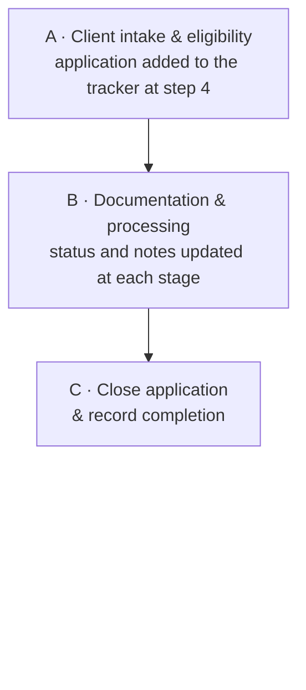
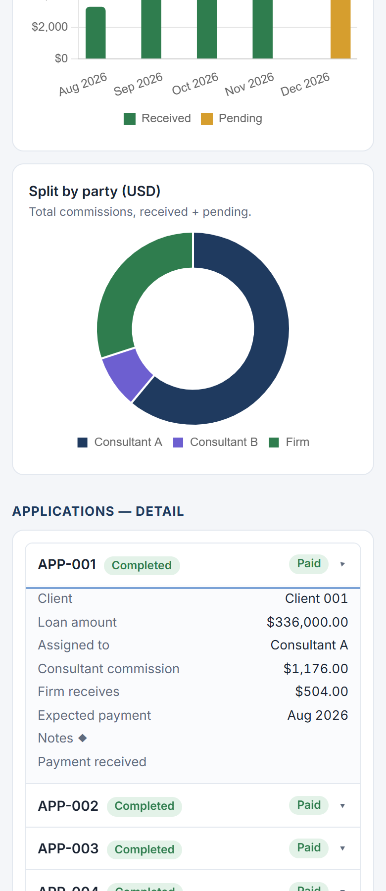

# Mortgage Financing Operations & Dashboard

I designed and built a tracking spreadsheet and dashboard for my mortgage financing practice. The system brings application stages, document follow-ups, commission splits, and expected payments into one operational view. This public demo recreates the workflow with 30 fictional applications.

### **[→ Open the live dashboard](https://camilanacli.github.io/mortgage-financing-operations/)**

[Download the demo spreadsheet (.xlsx)](https://raw.githubusercontent.com/CamilaNacli/mortgage-financing-operations/main/spreadsheet/mortgage-operations-demo.xlsx)

> **Professional Portfolio Demonstration** — This project is a portfolio demonstration based on a solution I developed and used in a real professional environment. All names, records, financial information, and other data presented are fictional and have been created exclusively for demonstration purposes. Original business information has been excluded to protect confidentiality. This demonstration showcases my practical experience, problem-solving skills, and ability to design and implement operational solutions using digital tools. *Amounts are shown in USD.*

---

## My role

- **Process design:** I mapped how an application moves from referral to completion and turned those stages into the statuses, fields and rules of the tracker.
- **Application follow-up:** I onboard clients referred by bank managers and real estate agencies, collect information with my own intake checklist, register applications on the financial institution's portal, request and organize documents, and follow pending items until completion.
- **Spreadsheet and dashboard:** I built the tracking spreadsheet (formulas for commissions, the split between parties and the expected payment month) and the dashboard that reads it.

> Credit decisions are made by the financial institution. My role is to prepare, organize, follow up and communicate.

## How it works

| Phase | Steps | Spreadsheet update |
| --- | --- | --- |
| **A · Client intake & eligibility** | Referral & first contact → needs assessment → intake checklist → application registration → income & eligibility check (by the institution) | The application is added to the tracker at **registration (step 4)** |
| **B · Documentation & application processing** | Document collection → secure document organization → processing & follow-up until fund release | Status, notes and expected completion month are updated at each stage |
| **C · Completion & operational reporting** | Close application and record completion → dashboard & reporting | Status set to *Completed*; completion date and payment status are recorded |

The dashboard reads the spreadsheet every time it is opened or refreshed. Step-by-step diagrams and the 11 application statuses: **[docs/workflow.md](docs/workflow.md)**.

## Example: which pending commissions are already scheduled?

Pending consultant commissions fall into two groups:

- **Scheduled:** completed applications that already have an expected payment month. In the demo data, USD 5,110 is expected in Dec 2026.
- **Not scheduled yet:** 13 applications still in progress, with USD 26,544 in pending consultant commissions and no payment month defined.

On the dashboard, select **Not scheduled** in the *Expected payment month* filter to list those 13 applications, or check the last rows of the *Summary by month* table.

## Dashboard features

- **Overview:** applications in progress and completed, and total loan amount tracked.
- **Commissions by party:** total, received and pending for each consultant and for the firm.
- **Monthly view:** consultant commissions received and pending by expected payment month, plus the amount not yet scheduled.
- **Filters:** expected payment month (including *Not scheduled*), consultant, application status, and search by client or application ID.
- **Application detail:** a table on desktop; on phones, a compact list showing ID, status and payment, with each application expandable for the other fields.
- **Live data:** **Refresh** reloads the spreadsheet; no data is typed into the dashboard.

Items added only to make the demo easier to explore are marked with ◆ on the dashboard. See [Demo environment](docs/demo-environment.md#demonstration-extensions).

## Tools

| Purpose | Tool |
| --- | --- |
| Tracking and calculations | Google Sheets: formulas, drop-down lists, summary tabs |
| Document organization | Google Drive: restricted folders per client and application |
| Spreadsheet → dashboard | Google Sheets "Publish to the web" (CSV), read on every load or refresh |
| Dashboard | Web page with Chart.js (on WordPress in the original; on GitHub Pages in this demo) |

## Documentation

| Document | Content |
| --- | --- |
| [Workflow](docs/workflow.md) | Step-by-step diagrams, my activities at each step, application statuses |
| [Tracking spreadsheet](docs/tracking-spreadsheet.md) | Tabs, fields, formulas and commission logic |
| [Demo environment](docs/demo-environment.md) | How to explore and test the demo, demonstration extensions |
| [Data confidentiality](docs/data-confidentiality.md) | How client information is protected, and how this public version was prepared |
