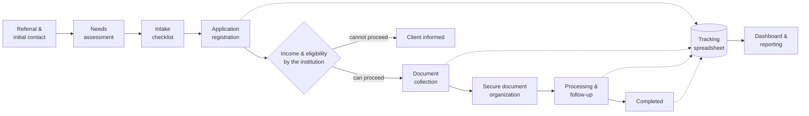
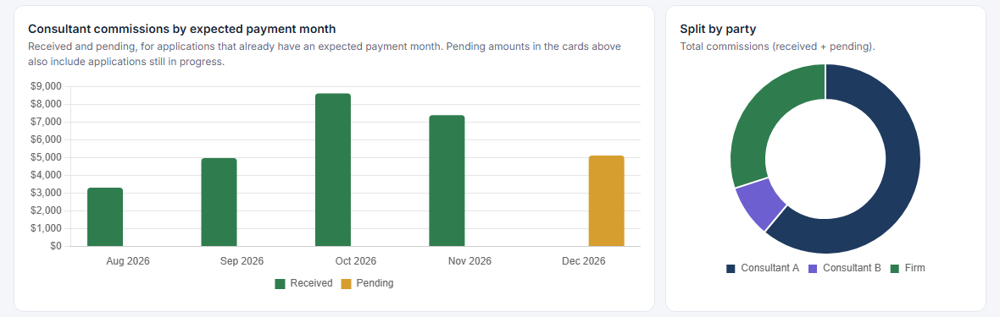
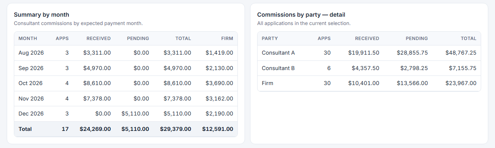

# Mortgage Financing Operations & Dashboard

> **Professional Portfolio Demonstration**
>
> This project is a portfolio demonstration based on a solution I developed and used in a real professional environment. All names, records, financial information, and other data presented are fictional and have been created exclusively for demonstration purposes.
>
> Original business information has been excluded to protect confidentiality. This demonstration showcases my practical experience, problem-solving skills, and ability to design and implement operational solutions using digital tools.

**Category:** Independent Business / Professional Project

An operational tracking and reporting solution developed for my independent mortgage financing business, supporting client onboarding, application management, document coordination, process monitoring, and dashboard reporting.

**Live demo:** https://camilanacli.github.io/mortgage-financing-operations/


---

## Business Context

This solution supports my independent professional activity as a banking correspondent specialized in **real estate financing**. Clients are referred to me by bank managers and real estate agencies. I guide them from the first conversation until the financing is completed.

Each application involves several parties (client, financial institution, real estate agency), sensitive documents and many steps that can stall: missing documents, additional requests, appraisals and contract signing. With several applications running at the same time, I needed a reliable way to:

- know where every application stands and what it is waiting on;
- keep financial information (loan amounts, commissions, expected payments) accurate and up to date;
- see the whole operation at a glance, without rebuilding reports by hand.

## My Role & Responsibilities

I manage the full operation end to end:

- **Client onboarding & needs assessment:** first contact, understanding the client's goals, the property and the type of financing.
- **Intake & application registration:** collecting information with my own intake checklist and registering the application on the financial institution's portal.
- **Document management:** requesting, reviewing and organizing client documents, with strict confidentiality.
- **Application processing & follow-up:** tracking pending items and additional requests until completion, and keeping clients and other parties informed.
- **Tracking & reporting:** I designed and maintain the tracking spreadsheet and the dashboard presented here.

**Note:** credit approval decisions are made by the financial institution. My role is to prepare, organize, follow up and communicate. I do not approve financing.

## End-to-End Operational Workflow



Each step is described in [docs/workflow.md](docs/workflow.md).

## Tools & Technologies

| Purpose | Tool |
| --- | --- |
| Operational tracking and calculations | Google Sheets (formulas, drop-down lists, summary tabs) |
| Document organization | Google Drive (restricted folders per client and application) |
| Spreadsheet → dashboard connection | Google Sheets "Publish to the web" (CSV of the Applications tab), read by the dashboard on every load or refresh |
| Dashboard | Web page (HTML + Chart.js) published on WordPress in the original; on GitHub Pages in this demo |

**How the demo is connected:** a separate demo Google Sheet (fictional data only) publishes its Applications tab as CSV. The dashboard reads that CSV, the same architecture as the original solution. If the published sheet cannot be reached, the dashboard falls back to the copy in [`data/applications.csv`](data/applications.csv).

## Tracking Spreadsheet

The spreadsheet is the single source of truth. Each application is one row, and the spreadsheet calculates the rest automatically:

- **Application data:** ID, client, dates, property value, loan amount, transaction type, financing program, status, assigned consultant(s), notes.
- **Monthly production tiers:** for standard mortgages, the commission rate depends on the **total production of the month**. When the month reaches a higher tier, every application in that month is recalculated.
- **Commission rules by transaction type:** tiered rate, fixed fee, or rate based on the loan's interest rate, each with a cap per application.
- **Split between parties:** the consultants' share and the amount retained by the firm, including applications shared between two consultants.
- **Expected payment month and payment status** (Paid / Pending).
- **Monthly Summary tab:** totals received and pending, current-month production and a 12-month forecast of pending payments.

Details: [docs/tracking-spreadsheet.md](docs/tracking-spreadsheet.md) · Demo file: [spreadsheet/mortgage-operations-demo.xlsx](spreadsheet/mortgage-operations-demo.xlsx)

## Dashboard & Reporting

The dashboard reads the spreadsheet every time it is opened or refreshed. Nothing is typed into the dashboard, so it always reflects the current data.

Features that reproduce the original dashboard:

- **Header:** last update time and a **Refresh** button that reloads the spreadsheet data.
- **Filters:** expected payment month, assigned consultant, search by client or application ID, and clear filters.
- **Indicators:** applications in progress and applications completed.
- **Commissions by party:** total, received and pending for each consultant and for the firm.
- **Charts:** received and pending by month (side-by-side bars), and commissions by party (doughnut).
- **Application detail table:** when a month is selected, it becomes a month detail view; it shows a message when no application matches the filters.
- **Summary by month** with a total row, and **commissions by party — detail**.



| Application detail | Summary tables |
| --- | --- |
|  |  |

### Demonstration extensions

These items were added only to make the demo easier to explore. They are labeled "demo extension" on the dashboard and were not part of the original solution:

- application status filter and the "Applications by status" chart;
- "Withdrawn" and "Loan volume" indicators, and the Notes column in the detail table;
- **Load spreadsheet** button, so visitors can test the dashboard with an edited copy of the demo file;
- the detailed workflow stages (Submitted, Income Assessment, Document Collection, In Processing, Contract Signing, Withdrawn), which represent the steps I follow, simplified for the demo.

## Data Confidentiality

My work involves identification documents, proof of income and financial information. Confidentiality is part of how the operation is designed:

- client documents are never stored in the tracking spreadsheet;
- documents are organized in separate Google Drive folders per client and application;
- access is limited to the people who need it to process the application.

For this public version, all names, IDs, amounts, dates and commission parameters were replaced by fictional values. No links, connections or files from the original system are included. See [docs/data-confidentiality.md](docs/data-confidentiality.md).

## Demo Environment

**Try it:** https://camilanacli.github.io/mortgage-financing-operations/

The dashboard is connected to the demo Google Sheet. Every time the page is opened or **Refresh** is clicked, it reads the sheet's published data. When the sheet changes, the dashboard reflects it after Google updates the published copy, which usually takes a few minutes.

**Explore it:**

1. Use the filters to explore applications by expected payment month, consultant or status. Selecting a month turns the detail table into a month view.
2. Download the [demo spreadsheet](spreadsheet/mortgage-operations-demo.xlsx) and open it in Google Sheets or Excel.
3. Change something, for example set an application's status to *Completed* and add a completion date, or mark a payment as *Paid*. The formulas recalculate the commission, split and expected payment month.
4. Back on the dashboard, click **Load spreadsheet** and select your edited file. All indicators, charts and tables update from the new data.

To connect the dashboard to your own copy, publish its Applications tab as CSV and open `…/mortgage-financing-operations/?csv=<published CSV link>`.

### Repository structure

```
mortgage-financing-operations/
├── index.html                          # demo dashboard (GitHub Pages)
├── dashboard/dashboard-embed.html      # same dashboard as a self-contained block (e.g., WordPress "Custom HTML")
├── data/applications.csv               # copy of the demo data (fallback if the published sheet is unavailable)
├── spreadsheet/mortgage-operations-demo.xlsx
└── docs/
    ├── workflow.md
    ├── tracking-spreadsheet.md
    ├── data-confidentiality.md
    └── images/
```

## Skills Demonstrated

End-to-end mortgage financing operations · Client onboarding & needs assessment · Financial documentation management · Application processing & tracking · Confidential information handling · Operational workflow management · Stakeholder communication · Google Sheets reporting · Dashboard development · Process organization & improvement
