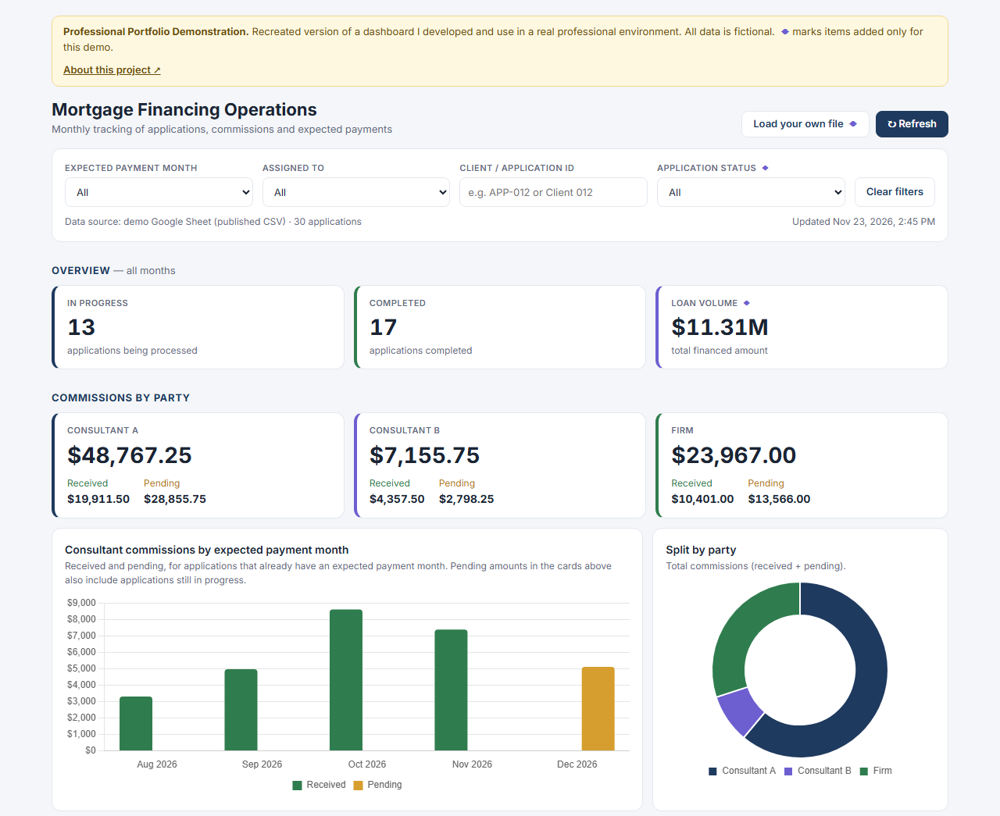
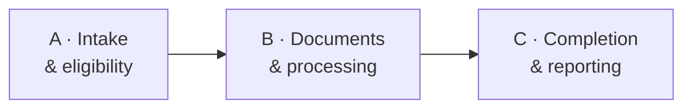
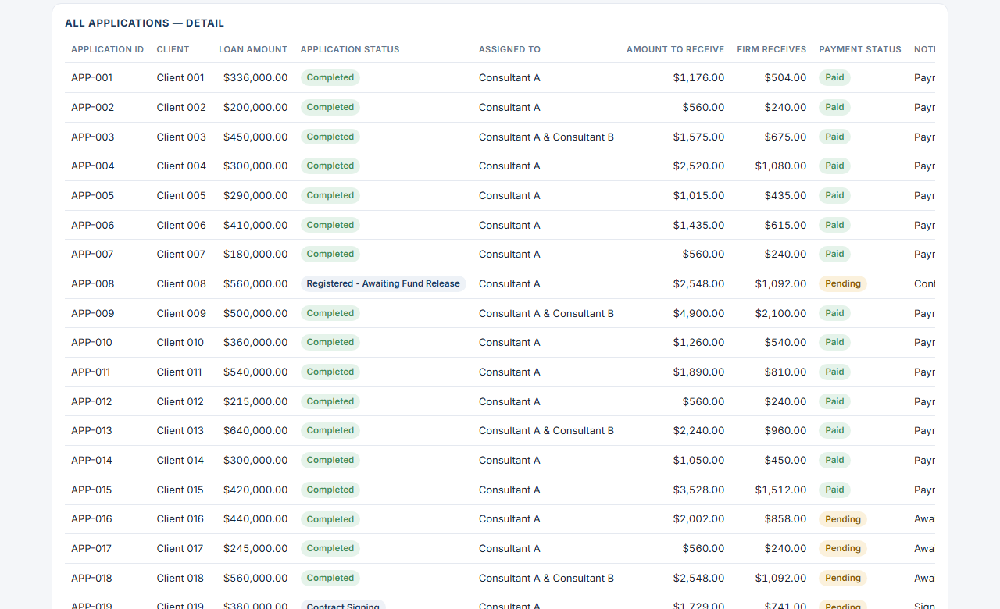

# Mortgage Financing Operations & Dashboard

> **Professional Portfolio Demonstration**
>
> This project is a portfolio demonstration based on a solution I developed and used in a real professional environment. All names, records, financial information, and other data presented are fictional and have been created exclusively for demonstration purposes.
>
> Original business information has been excluded to protect confidentiality. This demonstration showcases my practical experience, problem-solving skills, and ability to design and implement operational solutions using digital tools.

A tracking spreadsheet and a live dashboard I built to manage mortgage financing applications end to end, in my work as an independent banking correspondent. They keep every application, its current stage, the commissions and the expected payments in one place, so the whole operation can be followed at a glance.

**[Open the live dashboard](https://camilanacli.github.io/mortgage-financing-operations/)** · **[Download the demo spreadsheet (.xlsx)](https://raw.githubusercontent.com/CamilaNacli/mortgage-financing-operations/main/spreadsheet/mortgage-operations-demo.xlsx)**

---

## The problem

Each financing application moves through many stages: registration, credit analysis, appraisal, contract signing, registry and fund release. Each stage depends on documents and replies from the client, the financial institution and other parties. With several applications running at the same time, I needed a reliable way to:

- know where every application stands and what it is waiting on;
- keep loan amounts, commissions and expected payments accurate;
- see the operation at a glance, without rebuilding reports by hand.

## The solution

- **Tracking spreadsheet (Google Sheets):** one row per application, drop-down lists for each stage, and formulas that calculate commissions, the split between parties and the expected payment month.
- **Dashboard (web page):** reads the spreadsheet every time it is opened or refreshed, and shows indicators, commissions by party, monthly payments and application details, with filters.

## My role & responsibilities

- **Client onboarding & needs assessment:** first contact with clients referred by bank managers and real estate agencies; understanding their goals, the property and the type of financing.
- **Intake & application registration:** collecting information with my own intake checklist and registering the application on the financial institution's portal.
- **Document management:** requesting, reviewing and organizing client documents with strict confidentiality.
- **Processing & follow-up:** tracking pending items and additional requests until completion, keeping clients and other parties informed.
- **Tracking & reporting:** I designed and maintain the tracking spreadsheet and the dashboard.

> Credit approval decisions are made by the financial institution. My role is to prepare, organize, follow up and communicate.

## Operational workflow

| Phase | Steps |
| --- | --- |
| **A · Client intake & eligibility** | Referral & first contact → needs assessment → intake checklist → application registration → income & eligibility check (by the institution) |
| **B · Documentation & application processing** | Document collection → secure document organization → processing & follow-up until fund release |
| **C · Completion & operational reporting** | Completed application → tracking spreadsheet updated → dashboard & reporting |

The tracking spreadsheet is updated throughout all three phases, and the dashboard reads it. Step-by-step diagrams and the 11 application statuses are in **[docs/workflow.md](docs/workflow.md)**.

## Dashboard features

- **Indicators:** applications in progress and completed.
- **Commissions by party:** total, received and pending for each consultant and for the firm.
- **Monthly view:** consultant commissions received and pending by expected payment month.
- **Filters:** expected payment month, consultant, application status, and search by client or application ID.
- **Detail tables:** all applications (or a single month), summary by month, and commissions by party.
- **Live data:** a **Refresh** button reloads the spreadsheet; no data is typed into the dashboard.

A few items were added only to make the demo easier to explore, and are marked with ◆ on the dashboard. See [Demo environment](docs/demo-environment.md#demonstration-extensions).

## Tools & technologies

| Purpose | Tool |
| --- | --- |
| Tracking and calculations | Google Sheets: formulas, drop-down lists, summary tabs |
| Document organization | Google Drive: restricted folders per client and application |
| Spreadsheet → dashboard | Google Sheets "Publish to the web" (CSV), read on every load or refresh |
| Dashboard | Web page with Chart.js (on WordPress in the original; on GitHub Pages in this demo) |

## Documentation

| Document | Content |
| --- | --- |
| [Workflow](docs/workflow.md) | Step-by-step diagrams, my activities at each step, application statuses |
| [Tracking spreadsheet](docs/tracking-spreadsheet.md) | Tabs, fields, formulas and commission logic |
| [Demo environment](docs/demo-environment.md) | How to explore and test the demo, demonstration extensions, repository structure |
| [Data confidentiality](docs/data-confidentiality.md) | How client information is protected, and how this public version was prepared |

## Skills demonstrated

Mortgage financing operations · Client onboarding · Financial documentation management · Application tracking · Operational workflow management · Confidential information handling · Google Sheets reporting · Dashboard development
