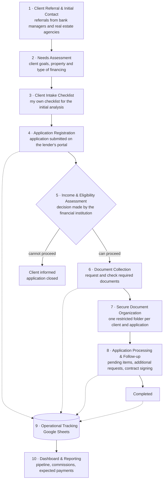

# End-to-End Operational Workflow

This is the general workflow I follow for each mortgage financing application, from the first referral to completion. It describes my own process as an independent banking correspondent. It does not describe any financial institution's internal procedures.

> Credit decisions belong to the financial institution. My role is to guide the client, organize the information and documents, register and follow up on the application, and keep everyone informed.

## Steps

| # | Step | What I do | Tracked in the spreadsheet |
| --- | --- | --- | --- |
| 1 | **Client Referral & Initial Contact** | Receive referrals from bank managers and real estate agencies and make the first contact with the client. | — |
| 2 | **Needs Assessment** | Talk with the client to understand their needs, the property and the characteristics of the transaction. | — |
| 3 | **Client Intake Checklist** | Send a checklist I created to collect the information needed for the initial analysis. | — |
| 4 | **Application Registration** | Register the client and submit the application on the financial institution's portal. | Application ID, client, registration date, values, transaction type, program |
| 5 | **Income & Eligibility Assessment** | Check the result of the income assessment and whether the application can proceed, according to the institution's criteria and decision. | Application status |
| 6 | **Document Collection** | When the application can proceed, request and review the required documents. | Status, documents submitted date |
| 7 | **Secure Document Organization** | Organize documents in Google Drive, one folder per client and application, with access limited to authorized people. | — (documents are never stored in the tracker) |
| 8 | **Application Processing & Follow-up** | Follow pending items, additional requests and remaining steps until completion, keeping the client and other parties informed. | Status, notes, expected completion month, completion date |
| 9 | **Operational Tracking** | Keep the tracking spreadsheet up to date as the single source of truth for every application. | All fields |
| 10 | **Dashboard & Reporting** | Use the dashboard connected to the spreadsheet to monitor the pipeline, commissions and expected payments. | — (reads the spreadsheet) |

## Application statuses used in the demo

| Status | Meaning |
| --- | --- |
| Submitted | Application registered on the lender's portal |
| Income Assessment | Waiting for the institution's income and eligibility result |
| Document Collection | Collecting and reviewing the client's documents |
| In Processing | Application under processing by the institution (appraisal, additional requests) |
| Contract Signing | Waiting for contract signing |
| Completed | Financing completed |
| Withdrawn | Client withdrew or the application could not proceed |

*The status names are a simplified, English version of the stages above, created for the demonstration.*
