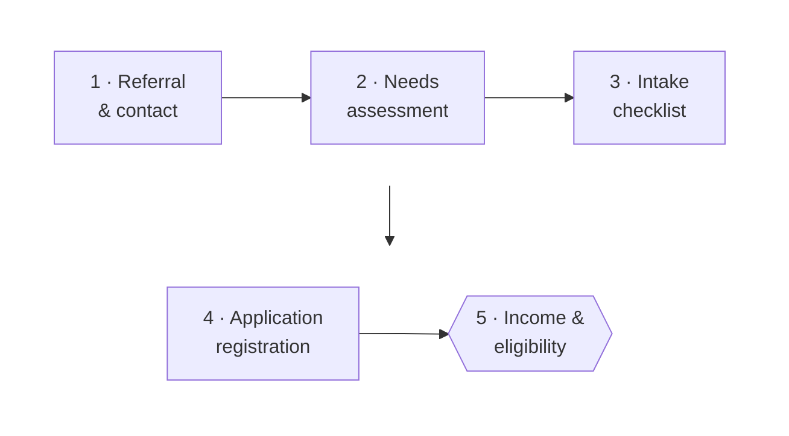
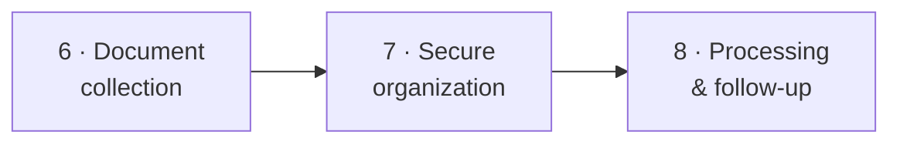
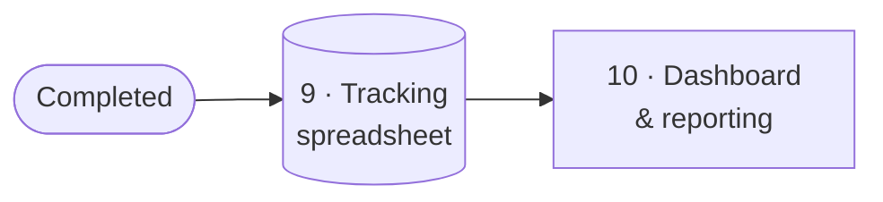
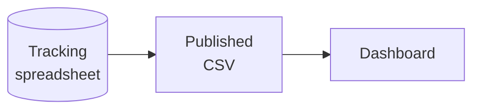

# End-to-End Operational Workflow

This is the general workflow I follow for each mortgage financing application, from the first referral to completion. It describes my own process as an independent banking correspondent. It does not describe any financial institution's internal procedures.

> Credit decisions belong to the financial institution. My role is to guide the client, organize the information and documents, register and follow up on the application, and keep everyone informed.

The process has three phases. Each diagram below covers one phase, in the order I work.

### A · Client intake & eligibility

Step 5 is decided by the financial institution. If the application can proceed, it moves to phase B. If not, I inform the client and the application is closed.

### B · Documentation & application processing

Processing covers the remaining stages until completion: appraisal, contract signing, registry and fund release (see [Application statuses](#application-statuses)).

### C · Completion & operational reporting

### How tracking supports every phase

The spreadsheet is not a final step only: it is updated from step 4 onward, every time an application changes stage. The dashboard reads it directly.

## Steps

| # | Step | What I do | Tracked in the spreadsheet |
| --- | --- | --- | --- |
| 1 | **Client Referral & Initial Contact** | Receive referrals from bank managers and real estate agencies and make the first contact with the client. | — |
| 2 | **Needs Assessment** | Talk with the client to understand their needs, the property and the characteristics of the transaction. | — |
| 3 | **Client Intake Checklist** | Send a checklist I created to collect the information needed for the initial analysis. | — |
| 4 | **Application Registration** | Register the client and submit the application on the financial institution's portal. | Application ID, client, registration date, values, transaction type, program |
| 5 | **Income & Eligibility Assessment** | Check the result of the income assessment and whether the application can proceed, according to the institution's criteria and decision. | Application status |
| 6 | **Document Collection** | When the application can proceed, request and review the required documents. | Status, documents submitted date |
| 7 | **Secure Document Organization** | Organize documents in Google Drive, one folder per client and application, with access limited to authorized people. | — (documents are never stored in the tracker) |
| 8 | **Application Processing & Follow-up** | Follow pending items, additional requests and remaining steps until completion, keeping the client and other parties informed. | Status, notes, expected completion month, completion date |
| 9 | **Operational Tracking** | Keep the tracking spreadsheet up to date as the single source of truth for every application. | All fields |
| 10 | **Dashboard & Reporting** | Use the dashboard connected to the spreadsheet to monitor the pipeline, commissions and expected payments. | — (reads the spreadsheet) |

## Application statuses

The tracking spreadsheet uses a drop-down list with the stages an application goes through, in order. These are the same stages used in the original solution, translated into English:

| # | Status | Meaning |
| --- | --- | --- |
| 1 | Submitted | Application registered on the lender's portal |
| 2 | Awaiting Insurance | Waiting for the insurance required for the financing |
| 3 | Application Sent | Application sent to the financial institution |
| 4 | Under Review | Under analysis by the institution (e.g., income and eligibility) |
| 5 | Property Appraisal | Property appraisal requested or scheduled |
| 6 | Application Under Review | Final review of the application by the institution |
| 7 | Contract Signing | Contract ready for signing |
| 8 | In Registry Recording | Contract being recorded at the property registry office |
| 9 | Registered - Awaiting Fund Release | Contract registered; waiting for the funds to be released |
| 10 | Funds Released | Funds released by the institution |
| 11 | Completed | Process completed |
